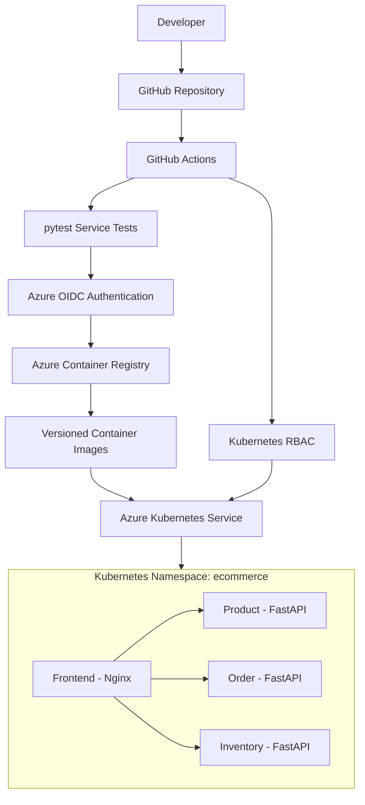

# E-Commerce Microservices on Azure AKS

## 1. Project Overview

This project demonstrates how to build, containerize, test, and deploy a microservices-based e-commerce application to Microsoft Azure Kubernetes Service (AKS) using Docker, Azure Container Registry (ACR), GitHub Actions, Azure Workload Identity Federation (OIDC), and Kubernetes RBAC.

The goal is to demonstrate an automated, repeatable, and security-conscious CI/CD process for deploying containerized applications to Kubernetes.

**Repository:** https://github.com/georgelolu/ecommerce-microservices-aks

### Technology Stack

- **Application services:** Python and FastAPI
- **Frontend:** Nginx serving static HTML
- **Containerization:** Docker
- **Container registry:** Azure Container Registry
- **Orchestration:** Azure Kubernetes Service
- **CI/CD:** GitHub Actions
- **Authentication:** Microsoft Entra ID and GitHub OIDC
- **Authorization:** Kubernetes Role-Based Access Control
- **Application testing:** pytest
- **Cloud provider:** Microsoft Azure
- **Source control:** Git and GitHub

## 2. Architecture

The diagram represents the logical architecture and intended application relationships. Actual browser-to-API connectivity must be verified separately; Kubernetes internal service names are not automatically accessible from a user's browser.

### Component responsibilities

**Frontend**

Nginx serves the static e-commerce website. Its Kubernetes Service is configured as `ClusterIP`, so the frontend is not directly exposed through a public Kubernetes Service.

**Product service**

A FastAPI microservice responsible for product-related API operations.

**Order service**

A FastAPI microservice responsible for order-related API operations. Order data is held in memory in the current implementation, so it is not durable across application restarts.

**Inventory service**

A FastAPI microservice responsible for inventory-related API operations.

**Azure Kubernetes Service**

AKS orchestrates the containers, manages pod scheduling, performs health checks, and maintains the desired replica count.

**Azure Container Registry**

ACR stores the container images built by GitHub Actions. The registry is named `petclinicacr3595`, with the login server `petclinicacr3595.azurecr.io`.

**GitHub Actions**

The pipeline tests the application, authenticates to Azure using OIDC, publishes versioned container images, and updates the Kubernetes deployments.

## 3. CI/CD Workflow

The deployment workflow is defined in `.github/workflows/ci.yml`.

The process is:

1. A developer commits and pushes changes to GitHub.
2. GitHub Actions runs automated tests for the product, order, and inventory services.
3. The deployment job runs for pushes to the `main` branch when the required tests pass.
4. GitHub Actions authenticates to Microsoft Entra ID using OIDC.
5. The workflow authenticates to Azure Container Registry.
6. Docker builds the four application images: frontend, product, order, and inventory.
7. Images are tagged with the Git commit SHA and pushed to ACR.
8. The workflow obtains AKS credentials and configures the Kubernetes authentication context.
9. Kubernetes RBAC permissions are checked.
10. The workflow updates the existing deployments to use the new image versions.
11. Kubernetes rollout status checks verify that the deployments become available.

Using commit-SHA image tags improves traceability because a deployment can be associated with a specific source revision.

## 4. Security Design

### OIDC authentication

GitHub Actions uses Microsoft Entra ID workload federation instead of a long-lived Azure client secret stored in GitHub.

The federated credential restricts token exchange to the configured GitHub repository and `main` branch subject.

Benefits include reduced secret-management overhead and less risk from leaked long-lived credentials.

### Azure Container Registry permissions

The GitHub Actions service principal has the `AcrPush` role scoped to the container registry. This allows the pipeline to publish images without granting broad subscription-wide permissions.

### Kubernetes RBAC

The `github-deployer` Role and RoleBinding in the `ecommerce` namespace grant the deployment identity narrowly scoped permissions for deployment updates and the associated read operations.

The Role permits operations such as reading and patching deployments and reading ReplicaSets, pods, and Services. It does not grant unrestricted cluster-admin access.

### Internal service exposure

The frontend, product, order, and inventory Services currently use `ClusterIP`.

This keeps them internal to the cluster's networking model. Public access would require an explicitly configured ingress, gateway, or load-balancing solution.

## 5. Reliability and Resource Management

The Kubernetes manifests configure deployment replicas, health probes, and resource requests and limits.

These controls help Kubernetes determine when containers are healthy and how to schedule workloads.

The current demonstration uses one replica for each service. This validates the deployment workflow but does not provide production-grade high availability.

The application also lacks durable order storage. A production design should introduce persistent database storage and appropriate backup and recovery procedures.

## 6. Verified Deployment Results

The successful GitHub Actions run was:

- Workflow: E-Commerce Microservices CI/CD
- Run ID: `38635496605`
- Source commit: `f6d5236b419fed635b351369593ef1423e77b943`
- Branch: `main`

The run successfully completed the service tests, Azure OIDC authentication, ACR image publishing, AKS access checks, deployment updates, and rollout verification.

The four deployed image names were:

- `ecommerce-frontend`
- `ecommerce-product`
- `ecommerce-order`
- `ecommerce-inventory`

The cluster subsequently showed all four deployments ready and all four pods running without reported restarts.

The frontend was tested using Kubernetes port forwarding. Its Service was later returned to `ClusterIP`.

### Current infrastructure status

The AKS cluster `pet-clinic-aks` is stopped. Its management tier is Free, and its worker pool was reported as one `Standard_D2s_v7` node.

The source repository is clean, and the local `main` branch is synchronized with `origin/main`.

The Azure Container Registry and other retained Azure resources have not been deleted.

## 7. Limitations and Future Improvements

This is a DevOps demonstration project, not yet a production-ready e-commerce platform.

Recommended improvements include:

1. Add a persistent database for orders, products, and inventory as appropriate.
2. Implement integration tests for communication between microservices.
3. Add ingress or an API gateway, TLS certificates, and an appropriate public-access policy.
4. Add end-to-end tests for the complete customer shopping workflow.
5. Introduce observability using metrics, centralized logs, and alerting.
6. Evaluate horizontal pod autoscaling and additional replicas.
7. Add image vulnerability scanning and image signing to the release pipeline.
8. Introduce environment-specific deployment approvals and rollback procedures.
9. Review GitHub Actions runtime warnings and update actions when compatible replacements are available.
10. Use Azure Cost Analysis to monitor charges for retained resources.

## 8. Key Learning Outcomes

This project demonstrates practical experience with:

- Containerizing a multi-service application.
- Deploying applications to Kubernetes.
- Designing a GitHub Actions CI/CD pipeline.
- Using OIDC for cloud authentication.
- Applying least-privilege access controls.
- Publishing immutable, commit-tagged images.
- Validating deployment rollouts.
- Troubleshooting identity federation and deployment permissions.
- Managing cloud infrastructure costs by stopping an idle AKS cluster while preserving the project.

## Conclusion

The project provides a practical demonstration of automated cloud-native delivery using Azure, Kubernetes, Docker, and GitHub Actions. Its main achievement is a working CI/CD path from source control to a verified AKS deployment, with OIDC authentication and namespace-scoped Kubernetes permissions.

